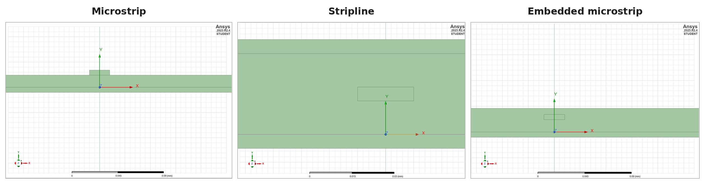
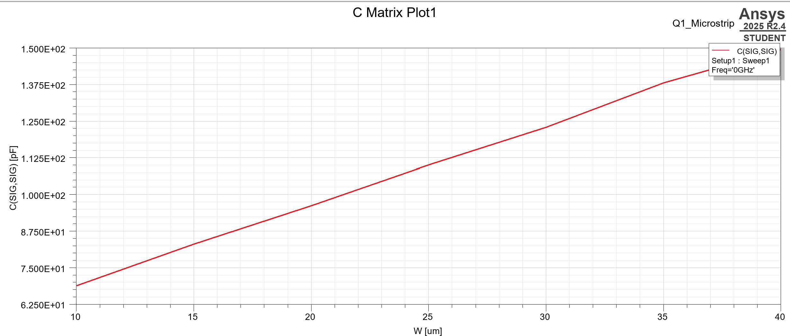
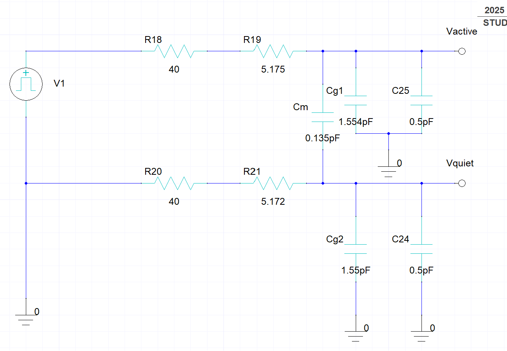
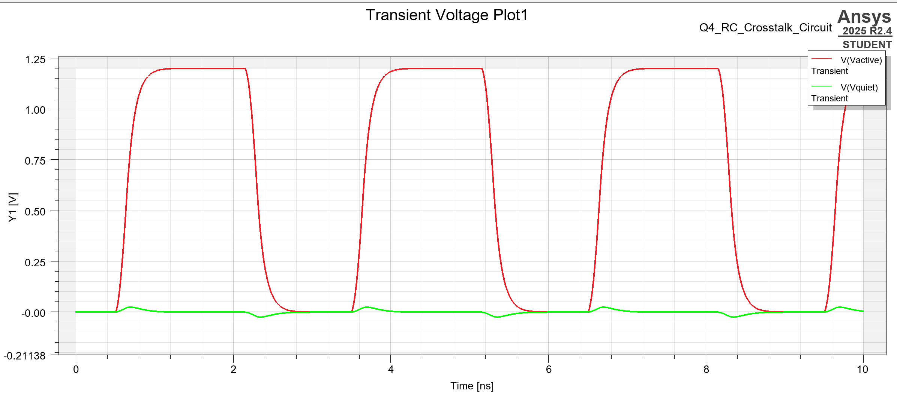

# Package Interconnect Signal Integrity

**2D field extraction and RC transient simulation of microstrip, stripline and embedded-microstrip package interconnects in Ansys Electronics Desktop.**


## Key results

|            Propagation delay            |      Peak crosstalk      |       Receiver rise time       |       Coupled structures       |
| :-------------------------------------: | :-----------------------: | :-----------------------------: | :-----------------------------: |
|           **78.19 ps**           |    **24.60 mV**    |       **252.84 ps**       |        **3 types**        |
| 50 % delay, 15 mm embedded interconnect | 2.05 % of the 1.2 V swing | 10–90 % at the active receiver | Microstrip, stripline, embedded |

These values come from the Q4 transient simulation of a lumped RC model built from the extracted per-unit-length parameters.

---

## 1. Project overview

At multi-GHz edge rates, package traces stop behaving like ideal wires. Their resistance slows edges, their capacitance to ground loads the driver, and their mutual capacitance couples noise onto neighbouring lines. How large each effect is depends on the cross-section: trace width, dielectric height, permittivity, and whether the trace sits on top of the substrate, is buried in it, or lies between two reference planes.

This project quantifies those effects for three package technologies (PWB, ceramic and organic/thin-film). It extracts RLGC parameters from 2D cross-sections, studies how they respond to geometry and material changes, and then carries the extracted parasitics into a circuit simulation. That last step turns them into the numbers a system designer cares about: delay, edge degradation and crosstalk.

The work was done as PBL 1 for *IC Fabrication and Packaging* (ECEG4071) at UPES Dehradun. The full report is in [`docs/`](docs/PBL1_Final_Report_Jehkaran.pdf).

## 2. Key features

- **Q2D field extraction:** capacitance/conductance (CG) and resistance/inductance (RL) matrices from parameterised 2D cross-sections at 1 GHz
- **RLGC matrices:** self and mutual terms, characteristic impedance, and modal attenuation for single and coupled lines
- **Parametric sweeps:** Optimetrics sweeps of trace width, dielectric height, εr and ground-plane width across three topologies (12 sweeps)
- **Coupled-line analysis:** ceramic coupled microstrip vs. stripline, comparing loss and normalized coupling
- **Soldermask loading:** PWB lines with and without soldermask, plus a 5–60 µm mask-thickness sweep
- **RC transient simulation:** extracted parasitics converted to a 15 mm lumped coupled-RC circuit and simulated in Ansys Circuit for delay, rise time and quiet-line crosstalk
- **Independent verification in Python:** scripts read the solved matrices and convergence data straight out of the archived Ansys project. They recompute every headline number, Z0 and modal attenuation from raw RLGC, and audit mesh convergence for all 66 solved variations, with no Ansys licence needed

## 3. Tools

| Tool                                      | Used for                                                                                                                                 |
| ----------------------------------------- | ---------------------------------------------------------------------------------------------------------------------------------------- |
| Ansys Electronics Desktop Student 2025 R2 | Project environment                                                                                                                      |
| 2D Extractor (Q2D)                        | Cross-section modelling, CG/RL extraction, modal and T-line data                                                                         |
| Optimetrics                               | Parametric sweeps                                                                                                                        |
| Nexxim Circuit                            | Transient simulation of the lumped RC crosstalk circuit                                                                                  |
| Python (NumPy, SciPy, Matplotlib)         | Reading solved matrices from the archive, waveform metrics, RLGC/modal analysis, sweep plots, convergence audit ([`scripts/`](scripts)) |

## 4. Interconnect structures


<sub>Q1 cross-sections in Ansys Q2D (Organic/Thin Film: W = 20 µm, T = 5 µm, H = 12 µm, εr = 3.2). The stripline view is drawn at a larger zoom; see the scale bars.</sub>

| Structure                     | Field environment                                                                                                    | Used in    |
| ----------------------------- | -------------------------------------------------------------------------------------------------------------------- | ---------- |
| **Microstrip**          | Trace on top of the dielectric. Part of the field runs in air, so the effective εr is lower and capacitance smaller | Q1, Q2, Q3 |
| **Stripline**           | Trace buried between two reference planes. The field is fully contained in the dielectric and well shielded          | Q1, Q2     |
| **Embedded microstrip** | Microstrip covered by a thin dielectric layer (6 µm assumed), sitting between the other two                         | Q1, Q4     |

### Technology parameters

| Substrate           | εr | tan δ | W (µm) | S (µm) | T (µm) | H (µm) |
| ------------------- | --- | ------ | ------- | ------- | ------- | ------- |
| PWB                 | 4.4 | 0.020  | 150     | 280     | 35      | 180     |
| Ceramic             | 9.8 | 0.002  | 80      | 300     | 15      | 125     |
| Organic / Thin Film | 3.2 | 0.010  | 20      | 30      | 5       | 12      |

Conductors are copper (σ = 5.8 × 10⁷ S/m), and the nominal ground/substrate width is 2000 µm.

## 5. Simulation methodology

```
 Geometry ──▶ Material assignment ──▶ Q2D extraction ──▶ Circuit simulation
 (parameterised   (Cu conductors,        (CG / RL matrices,   (lumped RC model,
  W, S, T, H,      substrate εr, tan δ,   Z0, modal data,      Nexxim transient,
  Wgnd)            soldermask)            Optimetrics sweeps)  waveform export)
```

1. **Geometry:** each cross-section is drawn with design variables (`W`, `T`, `H`, `er`, `Wgnd`, and the cover height for embedded lines), so every dimension can be swept.
2. **Material assignment:** signal and ground conductors are assigned copper, and the substrate (and soldermask in Q3) gets the εr and tan δ for its technology.
3. **Extraction:** Q2D solves for the CG and RL matrices at 1 GHz. The capacitance matrix uses the Maxwell convention, so C12 is negative and the physical coupling capacitance is |C12|.
4. **Circuit simulation (Q4):** per-unit-length values are multiplied by the 15 mm line length to give lumped components. The ground capacitors are derived as C<sub>g</sub> = (C11 − |C12|)·l and the mutual capacitor as C<sub>m</sub> = |C12|·l.

### Representative parameter sweep


<sub>Q1 microstrip: self-capacitance C(SIG,SIG) rises almost linearly from ≈ 68 to ≈ 148 pF/m as W goes from 10 to 40 µm, because a wider trace adds parallel-plate area to ground. All 12 sweeps are in .</sub>

### Q4 RC crosstalk circuit



| Component                                          | Value                                                    | Origin                   |
| -------------------------------------------------- | -------------------------------------------------------- | ------------------------ |
| Driver resistance (active & quiet)                 | 40 Ω                                                    | Specified                |
| Line resistance R1 / R2                            | 5.175 Ω / 5.172 Ω                                      | R11, R22 × 15 mm        |
| Ground capacitance C<sub>g1</sub> / C<sub>g2</sub> | 1.554 pF / 1.550 pF                                      | (C11 −\|C12\|) × 15 mm |
| Coupling capacitance C<sub>m</sub>                 | 0.135 pF                                                 | \|C12\| × 15 mm         |
| Receiver load                                      | 0.5 pF per line                                          | Specified                |
| Stimulus                                           | 0 → 1.2 V, 0.15 ns rise/fall, 1.5 ns width, 3 ns period | Specified                |

## 6. Results

### Q4: transient response


<sub>Active receiver (red) and quiet-line crosstalk (green). The quiet line shows a positive spike on each rising edge and a negative spike on each falling edge, the signature of capacitive (dV/dt) coupling.</sub>

| Metric                            | Value                                                                                  |
| --------------------------------- | -------------------------------------------------------------------------------------- |
| Active output 50 % crossing       | 0.6532 ns (input 50 % at 0.575 ns)                                                     |
| **50 % propagation delay**  | **78.19 ps**                                                                     |
| **10–90 % rise time**      | **252.84 ps** (input: 120 ps 10–90 %, from the 150 ps 0–100 % ramp)            |
| **Peak quiet-line voltage** | **24.60 mV (2.05 % of 1.2 V)**, on the falling edge (rising-edge peak +24.48 mV) |

All four values are reproduced exactly by [`waveform_analysis.py`](scripts/waveform_analysis.py) from the exported waveform ([`Q4_transient_voltage.csv`](results/q4_rc_crosstalk/Q4_transient_voltage.csv)). Crossings are linearly interpolated between samples, which are 2–27 ps apart on the first edge. Peak crosstalk is the largest absolute quiet-line sample over 0–10 ns. Annotated plot: [`analysis/waveform_metrics.png`](results/q4_rc_crosstalk/analysis/waveform_metrics.png).

### Q2: coupled ceramic microstrip vs. stripline (1 GHz)

| Quantity                     | Coupled microstrip | Coupled stripline |
| ---------------------------- | ------------------ | ----------------- |
| C11 (pF/m)                   | 144.48             | 293.13            |
| C12 (pF/m)                   | −2.756            | −3.981           |
| \|C12\| / C11                | 1.91 %             | **1.36 %**  |
| R11 (Ω/m)                   | 78.22              | 76.93             |
| Re(Z0,11) (Ω)               | 57.21              | 36.17             |
| Even-mode attenuation (dB/m) | **10.28**    | 15.02             |
| Odd-mode attenuation (dB/m)  | **9.92**     | 14.81             |

Modes are identified as even or odd from their eigenvectors. AEDT's "Mode 1 / Mode 2" numbering is solver order: it is even/odd for the microstrip but odd/even for the stripline. Full table, including inductive coupling and ε<sub>eff</sub>: [`analysis/q2_rlgc_comparison.md`](results/q2_coupled_lines/analysis/q2_rlgc_comparison.md).

### Q3: PWB soldermask impact (50 µm mask, εr = 3.5, 1 GHz)

| Quantity                     | No mask | 50 µm mask | Change            |
| ---------------------------- | ------- | ----------- | ----------------- |
| C11 (pF/m)                   | 81.90   | 93.65       | +14.4 %           |
| \|C12\| (pF/m)               | 5.77    | 9.18        | **+59.1 %** |
| Re(Z0,11) (Ω)               | 71.22   | 66.77       | −6.2 %           |
| Even-mode attenuation (Np/m) | 0.641   | 0.696       | +8.6 %            |
| Odd-mode attenuation (Np/m)  | 0.603   | 0.683       | +13.4 %           |

> **Correction to the report:** the report gives "Mode 1 attenuation 0.60275 → 0.69638 Np/m (+15.53 %)". Classifying the modes by eigenvector shows that this pairs the no-mask *odd* mode with the soldermask *even* mode, because AEDT numbered the modes differently in the two designs. Compared mode for mode, the soldermask raises attenuation by +8.6 % (even) and +13.4 % (odd). See [`analysis/q3_rlgc_comparison.md`](results/q3_soldermask/analysis/q3_rlgc_comparison.md).

The full 0–60 µm thickness sweep, plotted from the solved matrices: [`analysis/q3_capacitance_vs_tmask.png`](results/q3_soldermask/analysis/q3_capacitance_vs_tmask.png).

## 7. Engineering observations

- **Dielectric loading:** Adding dielectric above a trace replaces air with a higher-εr material. In Q3, a 50 µm soldermask raised self-capacitance by 14 % but mutual capacitance by 59 %, because the fringing field between adjacent traces passes through exactly the region the mask fills. Covering a line is therefore much worse for crosstalk than its impact on impedance alone suggests.
- **Geometry sensitivity:** Capacitance rose with W and εr and fell with H across all three topologies ([sweep plot from solved data](results/q1_parametric_studies/analysis/q1_capacitance_sweeps.png)).
- **Ground-plane width is below the mesh-noise floor:** for stripline, C11 wanders between 170.3 and 171.4 pF/m across 100–2000 µm with no trend. For embedded microstrip it is flat to ±0.2 % from 400 µm upward, and only the 100 µm point falls (−1.5 %). With a 1 % convergence target, any cutoff finer than "between 100 and 400 µm for embedded microstrip" cannot be resolved, which is why the report could not pin a sub-1 % threshold.
- **Absolute vs. normalized coupling:** Stripline had *higher* absolute |C12| than microstrip (3.98 vs 2.76 pF/m) but *lower* coupling relative to its self-capacitance (1.36 % vs 1.91 %). The second reference plane raises C11 more than C12. Normalized coupling is the better first-order indicator of crosstalk, although it does not by itself predict the quiet-line voltage for arbitrary terminations.
- **Loss vs. coupling trade-off:** Stripline had slightly lower conductor resistance but higher modal attenuation (≈ 15 dB/m vs ≈ 10 dB/m) on ceramic. The choice depends on whether attenuation or coupling dominates the budget.
- **Edge degradation:** The 120 ps (10–90 %) input edge became 252.84 ps at the receiver. The RC network of driver resistance, line resistance and load and ground capacitance acts as a low-pass filter. Crosstalk peaks line up with the active edges, which confirms that the coupling is capacitive.
- **Inductive coupling is not negligible:** in the Q4 structure L12/L11 = 10.4 %, larger than |C12|/C11 = 8.0 %. The unequal ratios are typical of an inhomogeneous dielectric, and they mean an RLC model would also show far-end (inductive) crosstalk that the RC model cannot.
- **Convergence, audited across all 66 solved variations** ([plot](results/q1_parametric_studies/analysis/q1_convergence.png), [`convergence_summary.csv`](results/q1_parametric_studies/analysis/convergence_summary.csv)):
  - Four Q1 stripline points ended above the 1 % delta-energy target: W = 25 µm, H = 9 µm, H = 21 µm and εr = 4.0, at 1.02–1.18 %. Each stopped at pass 7 of 10 with 1,628–1,872 triangles. The largest mesh anywhere in the project is 1,934 triangles, consistent with a mesh-size ceiling halting refinement.
  - Three more stripline points (W = 15 and 35 µm, H = 15 µm) converged in only 5–6 passes. Those solves had MinPasses = 1, while other points in the same sweep ran with MinPasses = 6. The risk is real: the εr = 3.0 stripline solve showed a delta energy of 0.027 % at pass 2 and 41 % at pass 3. A low minimum would have accepted the pass-2 mesh as converged.
  - All flagged points still sit on smooth C11 curves, so the trends are sound. The embedded-microstrip sweep converged cleanly at every point.
  - A 1 % energy criterion does not bound every matrix entry to 1 %: R11 still moved 1.5–4.7 % on the final pass in several designs, including 2.1 % for Q4, so extracted resistances carry a few percent of mesh uncertainty.
- **Soldermask geometry:** mask thicknesses below the 35 µm copper height made the full-width mask intersect the conductors. A corrected three-region side-mask geometry was used for 5–30 µm, so the thin-mask and thick-mask regimes are different geometric constructions.

## 8. Reproducing the work

1. Install **Ansys Electronics Desktop Student** (2025 R2 or later).
2. Open `models/ansys/PBL1.aedtz` with **File → Restore Archive** and choose a working folder to extract into.
3. The project contains one design per study:
   | Design                                                                | Study                |
   | --------------------------------------------------------------------- | -------------------- |
   | `Q1_Microstrip1`, `Q1_Stripline`, `Q1_Embedded_Microstrip`      | Q1 sweeps            |
   | `Q2_Coupled_Microstrip`, `Q2_Coupled_Stripline`                   | Q2 coupled lines     |
   | `Q3_PWB_Nomask`, `Q3_PWB_Soldermask`, `Q3_PWB_Soldermask_Fixed` | Q3 soldermask        |
   | `Q4_Embedded_Coupled_Microstrip`                                    | Q4 extraction        |
   | `Q4_RC_Crosstalk_Circuit`                                           | Q4 transient circuit |
4. To inspect extracted values, right-click **Analysis → Setup1 → Matrix Data** in any Q2D design for CG/RL matrices, Z0 and modal data. Sweeps are under **Optimetrics** and plots under **Results**.
5. To rerun, use **Simulation → Analyze All** for a design, or right-click the Optimetrics setup → **Analyze** for a sweep.
6. Exported plots and the Q4 waveform CSV are already in [`results/`](results), so nothing needs to be re-solved just to view the results.

### Verify the results with Python (no Ansys needed)

The archived project still contains every solved matrix and convergence table. The scripts read them straight from `PBL1.aedtz` and recompute the results independently:

```bash
pip install -r scripts/requirements.txt
python scripts/waveform_analysis.py        # Q4 delay, rise time, crosstalk
python scripts/rlgc_analysis.py            # Q2/Q3/Q4 RLGC, Z0, modal attenuation, 15 mm lumped values
python scripts/parameter_sweep_plotter.py  # Q1 and Q3 sweeps from solved data
python scripts/convergence_analysis.py     # adaptive-mesh audit of all 66 variations
```

| Script                                                              | Reads                                             | Reproduces / adds                                                                                                                                                                                           |
| ------------------------------------------------------------------- | ------------------------------------------------- | ----------------------------------------------------------------------------------------------------------------------------------------------------------------------------------------------------------- |
| [`waveform_analysis.py`](scripts/waveform_analysis.py)             | Q4 transient CSV                                  | 78.19 ps delay, 252.84 ps rise time, 24.5951 mV / 2.0496 % crosstalk, matching the report exactly                                                                                                           |
| [`rlgc_analysis.py`](scripts/rlgc_analysis.py)                     | Final R, L, G, C matrices                         | Lumped 5.175 Ω, 0.13536 pF and 1.5544 pF values. Re(Z0,11) and modal attenuation recomputed from raw RLGC match AEDT's own T-line and modal data (e.g. 57.205 Ω, 10.28 dB/m). Modes are labelled even/odd |
| [`parameter_sweep_plotter.py`](scripts/parameter_sweep_plotter.py) | Per-variation C matrices                          | Q1 C11 sweeps for stripline and embedded microstrip, Q3 C11 and\|C12\| vs mask thickness; unconverged points marked                                                                                         |
| [`convergence_analysis.py`](scripts/convergence_analysis.py)       | Per-pass convergence tables and matrices          | Delta energy vs mesh size, last-pass change of C11 and R11,`NOT_CONVERGED` / `EARLY_STOP` flags                                                                                                         |
| [`aedt_results.py`](scripts/aedt_results.py)                       | `.aedtz` or a restored `.aedtresults/` folder | Shared reader used by the scripts above                                                                                                                                                                     |

Outputs are written to `results/q*/analysis/` and are committed, so they can be inspected without running anything. The archive stores matrices by numeric variation ID, so the reader links each sweep point to its variable values by matching per-pass mesh sizes. Each link is recorded in the output CSVs and validated against the per-pass matrix count. Two εr points whose meshes were identical are resolved by C11 ordering.

## 9. Repository structure

```
package-interconnect-signal-integrity/
├── README.md
├── .gitignore
├── models/
│   └── ansys/
│       └── PBL1.aedtz                  Archived AEDT project (all designs)
├── results/
│   ├── q1_parametric_studies/
│   │   ├── geometry/                   Cross-sections of the 3 topologies
│   │   ├── plots/                      12 AEDT sweep plots: W, H, εr, Wgnd × 3 topologies
│   │   └── analysis/                   Sweep data + plot from solved matrices, convergence audit
│   ├── q2_coupled_lines/
│   │   ├── geometry/                   Coupled microstrip & stripline cross-sections
│   │   ├── Coupled_Microstrip/         CG, RL, mode data, T-line data
│   │   ├── Coupled_Stripline/          CG, RL, mode data, T-line data
│   │   └── analysis/                   RLGC comparison (even/odd modes), convergence
│   ├── q3_soldermask/
│   │   ├── geometry/                   No mask, 50 µm mask, corrected thin-mask
│   │   ├── nomask/  withmask/          CG & RL matrices
│   │   ├── impedance_modal_data/       T-line and modal data
│   │   ├── plots/                      C11, C12 vs. mask thickness (AEDT)
│   │   └── analysis/                   RLGC comparison, 0–60 µm sweep data + plot, convergence
│   └── q4_rc_crosstalk/                Cross-section, matrices, schematic,
│       │                               transient plots, Q4_transient_voltage.csv
│       └── analysis/                   Waveform metrics, RLGC, 15 mm lumped values, convergence
├── docs/
│   ├── PBL1_Final_Report_Jehkaran.pdf  Full report
│   └── images/                         README figures
└── scripts/
    ├── aedt_results.py                 Reads solved data from the .aedtz archive
    ├── waveform_analysis.py            Delay, rise time, crosstalk
    ├── rlgc_analysis.py                RLGC, Z0, modal and lumped-element analysis
    ├── parameter_sweep_plotter.py      Q1 / Q3 sweep plots from solved matrices
    ├── convergence_analysis.py         Adaptive-mesh convergence audit
    └── requirements.txt
```

## 10. Limitations

- **Student Edition mesh constraints:** some Q3 RL sweep points exceeded the AEDT Student mesh limit, and four Q1 stripline points stopped just above the 1 % convergence target (see Engineering observations). Baseline matrices and the CG sweep curves are complete.
- **Mesh uncertainty in R:** resistance values changed by up to ~4.7 % on the final adaptive pass, so extracted R is less certain than C.
- **Microstrip sweep data:** the `Q1_Microstrip1` design was archived without its solution data, so its four sweeps exist only as the AEDT plots in `results/q1_parametric_studies/plots/`. Re-solving it, or exporting the reports to CSV, would let `parameter_sweep_plotter.py --microstrip-csv-dir` include them.
- **Lumped RC assumption:** the Q4 circuit is a single-section lumped RC model, not a distributed coupled transmission line. Inductance and mutual resistance are not represented, so inductive crosstalk (L12/L11 = 10.4 % here), reflections and propagation effects are not captured. At 252 ps edges on a 15 mm line, a distributed RLGC model would be the next step.
- **Single-frequency extraction:** all matrices are extracted at 1 GHz. Frequency-dependent RLGC (skin effect, dielectric dispersion) was not modelled.
- **Ideal-source delay reference:** propagation delay is measured from the ideal source's specified 50 % point, not from a simulated input-node waveform.
- **Unmatched comparisons:** the three substrates use different dimensions and terminations, so the results do not show any one technology to be globally optimal.
- **Two soldermask regimes:** the 5–30 µm and 35–60 µm sweeps use different geometric constructions, so the two curves should not be read as one continuous trend.
- **Q1 scope:** the ground-plane width threshold was not determined to a precise cutoff, and E-field plots were not included.

## Author

**Jehkaran Singh**
GitHub: [@Jehka](https://github.com/Jehka)
